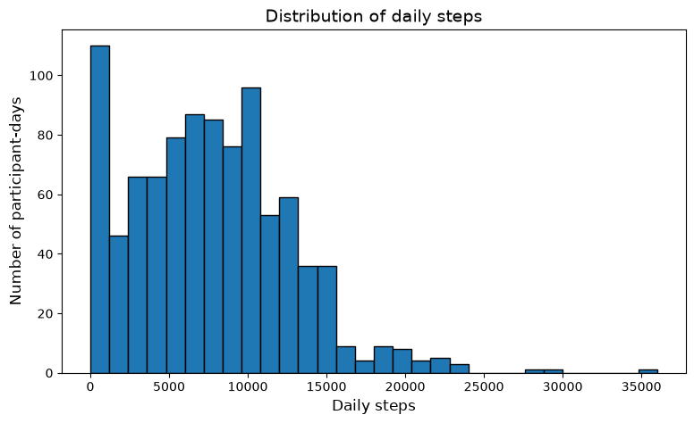
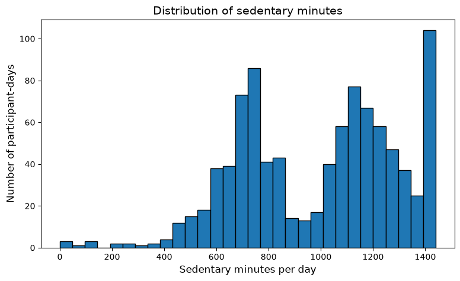
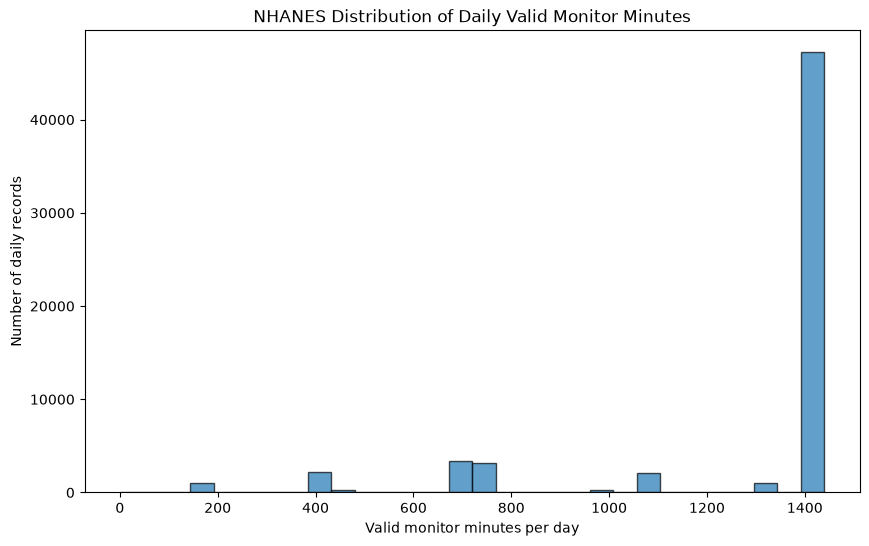
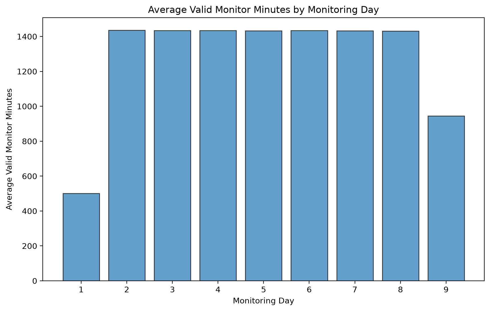

# Data Documentation

# 1. Datasheets

# Fitbit daily activity 

# Motivation

# [pargraph here]
# The original dataset is credit by Robert Furberg, Julia Brinton, Michael Keating, and Alexa Oritz. The datasets describes personal tracker data regarding Fitbit by valid users through survery distributed by via Amazon Mechanical Turk.

# Note, specific original research objective and funding source aren't doucmented in the dataset record via publisher.

# Composition 

# [pargraph here]
#  The selected activity has 940 rows and 15 cols, from April 12 to May 12 of 2016. Row represents tracker IDs daily summary. Publisher reports about 30 users, while released show 33 IDs. The sample data has no additional data on location and more.

# Figure 1. Distribution of daily steps across all 940 Fitbit records.

# Collection Process

# [pargraph here]
# Validation eligible users personal data tracker record through Amazon Mechanical Turk submitted during March to May 2016. The publisher states the users consented and the tracker types and habits varied. Some data aren't documentated such as eligibility for survey etc.

# Preprocessing

# [pargraph here]
# File contains merge daily summaries but whole process is not document on the cleaning situation. The EDA converts dat and create active minute and also weekeday and wekeend variables. It flag 72 non wear daya and seven contraditiocry records. Still all data in tact together.

# Figure 2. Distribution of daily sedentary minutes across all 940 Fitbit records. High sedentary totals prompted further inspection, but they do not prove that the tracker was not worn.

# Uses

# [pargraph here]
# Data to explore steps, active minutes, and weekday, weekend patterns. The observations do not establish the casuality or a population global pattern and doesn't 100% correlation with the users particpants in the survery. 

# Distribution

# [pargraph here]
# Zenodo as ZIP archive

# Maintenace

# [pargraph here]
# Hosts the origin release (May 31, 2016), any occuring updates aren't shown document of any sort it seems

# Sources

# https://doi.org/10.5281/zenodo.53894
# https://zenodo.org/api/records/53894
# https://www.kaggle.com/datasets/arashnic/fitbit
# https://www.kaggle.com/api/v1/datasets/view/arashnic/fitbit

# need to look into more here

# same process for 1.2

# 1.2 NHANES Physical Activity Monitor

# Motivation

# The dataset comes from CDC for health statistics. It measures movement using monitors to add information beyond what people report in surveys. 

# Composition

# The selected file has 61,168 rows and 15 cols, with 6,917 participants. A row represents person' monitoring day. Each person can have up to nine records. The public file includes people aged six and older.Some records are missing because people refused, didn't return the monitor, or had damaged devices with not good data.

# Figure 3. Distribution of valid monitoring minutes across all 61,168 NHANES daily records. Many records have close to 1,440 valid minutes, while others have shorter coverage.

# Figure 4. Avg valid monitoring minutes by NHANES monitoring days. Day 1 and 9 have shorten recording coverage than days 2 to 8. 

# Collection Process

# The data was collected during the 2011 to 2012 survey. People wore an actigraph monitor on  wrist. included seven days, The device recorded acceleration 80 times per sec. NHANES provides consent procedure.

# Preprocessing

# Cdc  checked data quality and created daily summaries on movement.An algo classified wake, sleep, and more. the EDA changes positive numeric values below 70 to zero,assume their are issues from reading the file. 61,168 rows.Weekday/weekend comparisons use days 2 to 8 and calculate PAXMTSD / PAXVMD when valid minutes are above zero.

# Uses

 # We use data compare monitoring, wake time + wear time , and weekday and the weekend movement. The current results are unweighted  of the record. They don't show cause and effect or provide national estimates. MIMS movement values aren't the same as Fitbit step counts to look out for on additional notes .

# Distribution

# CDC shares the data as a .xpt file.

# Maintenance

# CHS hosts the release, first published in 11/2020.The data no revision up to any changes it seem.

# 1.3 Supporting Dataset: NHANES Demographics (DEMO_G)

# Purpose

# The file is cdc for Health Statistics. It provides demographic information, survey weights, and survey design fields. It could support future weighted or demographic analyses.

# Composition

# The file is 9,756 rows and 48 cols. Each row represents one survey participant. Different fields have different age and eligibilee rules.

# Collection and Preprocessing

# interviewers collected demographic through household interviews. Some participants answered directly, while others had proxy respondents. CDC checked responses, skip patterns, and consistency. Some information left out restricted for confidentiality.

# Current Use

# acquisition notebook reads file and checks structure. The current EDA does not join it to PAXDAY_G or use its demographic fields and survey weights. BRFSS was also inspected during acquisition, but it is not in the revised version.

# Distribution and Maintenance

# CDC publishes the file in .xpt , release was first published in September 2013 and revised in January 2015.

# 2. Research Questions and Data Scope

# The target population is who/ what we want to describe. The access frame is who could be reach for by the collection process. The sample is the data we want to actually analyze.

# These are the revised questions from EDA.md. The older questions about sleep, demographic differences, income, education, and self reported activity are not implement  in the current EDA.

# Should add more here maybe, seem important

# Q1. How are Fitbit steps and active minutes related?

# Target: Fitbit activity day (April–May 2016)
# Frame: Eligible users (Mechanical Turk survey) and who could and would share tracker records.
# Sample: 940 daily records across 33 exported IDs.
# Limit: This volunteer sample does not show all avaliable Fitbit users + activity. Could show correlation to flatten data.

# Q2. Do Fitbit weekday and weekend patterns differ by person?

# Target: Within the user day to day weekday/weekend step patterns.
# Frame: The same volunteered Fitbit records.
# Sample: 32 IDs with both weekday and weekend observations.
# Limit: Day coverage differs between IDs.
# The summaries are details and great and still include suspected not wearing days records.

# Q3. How does NHANES measure movement, and can we compare Fitbit?

# Target: Movement measurements in the two study setting.
# Frame: The Fitbit release and public NHANES PAM release.
# Sample: The two primary files and their measurement documentation.
# Limit: The studies use different devices, periods, populations, and units and more. MIMS values cannot be directly treated as step counts.

# Q4. How does monitoring duration vary across nine days?

# Target: Monitoring coverage among eligible NHANES participants.
# Frame: Survey participants with public PAM records.
# Sample: All 61,168 daily records from 6,917 participants.
# Limit: Some eligible participants hass no monitor data.
# Also very imporant here, The first and last days are partial,and not every participant has nine complete records.

# Q5. Does wake-wear time differ on weekdays and weekends?

# Target: Wake wear patterns among us
# Frame: Eligible NHANES participants
# Sample: 47,643 records from monitoring days 2–8.
# Limit: These are unweighted daily record means.
# People with more recorded days have more influence.
# Monitor nonresponse and missing coverage remain.

# Q6. Is movement per valid minute higher on weekdays?

# Target: Duration normalized movement and within person patterns in the same NHANES population.
# Frame: Participants with public records.
# Sample: Days 2–8, with 47,639 non null movement ratios.
# Limit: The current EDA compares day type averages.
# The results do not establish significance or national estimates.

# Q7. Do Fitbit and NHANES show similar weekday/weekend patterns?

# Target: Study specific weekday/weekend patterns.
# Frame: The two separate collection settings.
# Sample: Fitbit's 32 complete ID pairs
# and NHANES day type summaries from days 2–8.
# Limit: These are different samples and comparison methods.
# Differences cannot be attributed to the device alone No people are matched between the datasets.

# 3. Codebook

# The tables cover the primary file columns profiled in the EDA and the columns created for analysis.

# Null means a missing value in a dataframe.

# F = Fitbit CSV and matching Fitabase field descriptions.
# N = CDC PAXDAY_G codebook.
# E = code in eda.ipynb.

# The Fitabase dictionary is a later reference. A matching 2016 dictionary has not been verified.

# 3.1 Fitbit Source Columns

# The file has no observed nulls in the saved pro

# 3.2 NHANES Day Source Columns

# Character fields are decoded from bytes to strings in the EDA.Monitoring-day and weekday codes are converted to integers in the summary and comparison tables.

# The saved profile reports no nulls in the source table.Very small positive reader values are handled separately.

# PAXVMD includes valid wake, sleep, non-wear, and unknown minutes.PAXAISMD describes device idle mode, not human sleep.PAXQFD counts flags, not invalid minutes.

# 3.3 Fitbit Derived Columns

# Polars weekday numbers are Monday = 1 through Sunday = 7.The Fitbit code uses 6 and 7 for weekends.

# 3.4 NHANES Derived Columns

# NHANES weekday codes are Sunday = 1 through Saturday = 7. average daily records

# 3.5 Supporting Fields

# DEMO_G and BRFSS are inspected in the acquisition notebook, but their fields are not used in the current EDA calculations.If we later use them, we must add their field definitions, missing valuecodes, and transformations to this codebook.

# 4. Recipe: Raw Files to Analysis Dataframes

# Environment

# The notebooks use Python, Polars, pandas, and matplotlib.

# Raw Inputs

# dailyActivity_merged.csv. and PAXDAY_G.xpt (NHANES 2011 to 2012 release)

# Ordered Steps

# Row Accounting

# There are 47,639 non null movement ratios. The group mean skips the four null ratios. The 4 still contribute when needed.

# Joins

# No joins in .eda

# Analysis Tables

# These tables are made in memory with figures and summaries in notebooks(output)

# Reproducibility Limits

# The notebooks require raw files. Download dates and exact package versions are not recorded.

# 5. Access, Versioning, and Reuse

# Access Records

# orignials file for data are not recorded as as long for the kaggle data but the release identities despribe the intended versions on inputs. Make sure to record data for actual.

# Findable

# original Fitbit release is DOI and CDC pages identify the NHANES cycle, files, + codebooks.

# Accessible

# Publisher files can be downloaded online. The repository provides notebooks + outputs.

# Interoperable

# The source files use csv/ sas xport. codebook is using units, identifiers, and day codes. Fitbit and NHANES weekend rules use diff numbering systems. Also MIMS and steps are different measurements.

# Reusable

# original Fitbit data follows conditions: credit the creators, link the source and license, and describe changes. Also The Kaggle CC0 label conflicts with the original release.

# NHANES data are generally public domain.
# NCHS conditions limititation use to statistical analysis and reporting.

# 6. People, Representation, and Potential Effects

# Representation

# Fitbit represents volunteers who owned a tracker,could share records, and took part in the recruitment process.People without a tracker (without access) aren't in coverage zone. Doesn't provide much on demographics

# NHANES has a probability design for samples, but the public PAM file only includes participants with monitor data. and active-duty military personnel.

# Missing Coverage and Possible Bias

# Monitor refusal, failed returns, damaged devices, and incomplete recording can change who appears in the data. The Fitbit non wear labels are uncertain.

# Potential Uses and Harms

# The analysis can help explain recorded activity patterns. It should not be used to diagnose people, judge their effort to make a claim.

# CARE Principles

# CARE was developed for Indigenous data gov . We use it as a lens for thoughts about  people and their responsibilities.

# Collective Benefit

# The intends benefit is learning how activity measurements work and describing within the limitation happens.

# Authority to Control

# Respect the documented consent framework.

# Responsibility

# Keep source information and explain processing choices.Report missing coverage, avoid uncertainty and unfinished data.

# Ethics

# Consider these thoughts on how activity labels could misrepresent people. Avoid unsupported health, demographic and more and also explain limitations before others use the results for decisions on assumptions.

