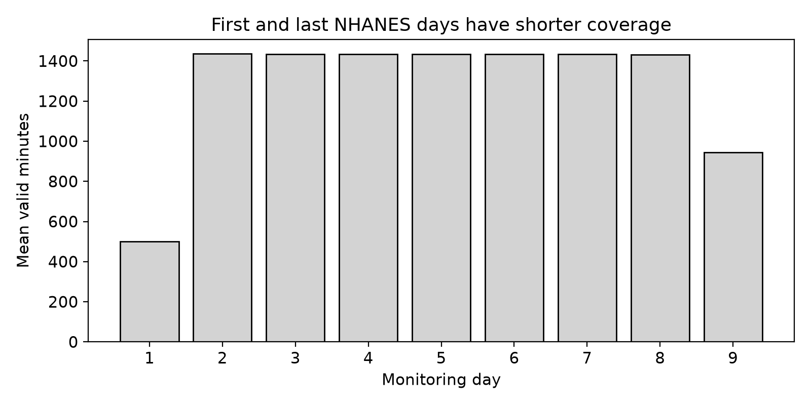
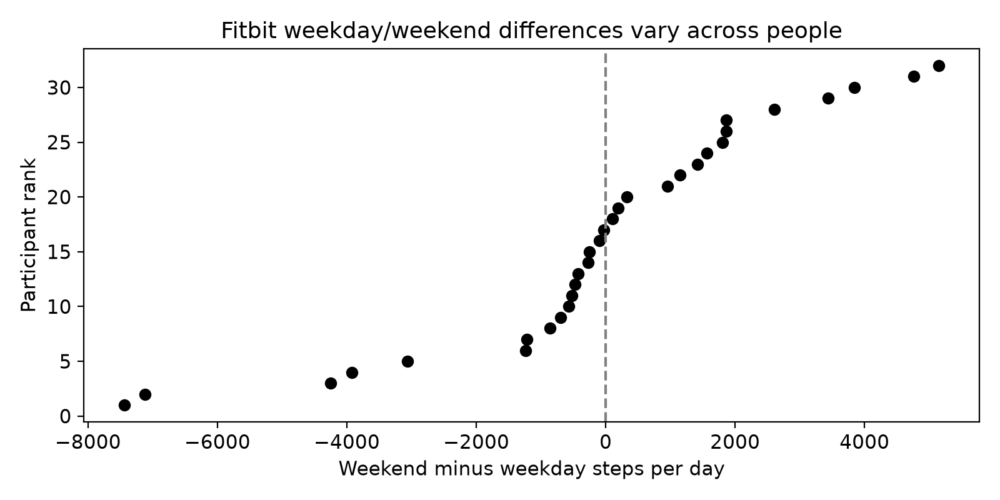
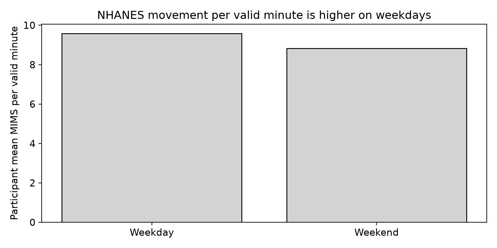

# cs418-Fitness-Analytics

Personal Exercise and Fitness Analytics group repository.

GROUP MEMBERS: Hashim, Shriya, Yumna, G, Guillermo

First Question:
**How do daily steps, active minutes, and sleep relate to each other? Are the patterns different on weekends compared to weekdays?**

Second Question:

**How does measured physical activity vary by age, sex, and BMI?**

Third Question:

**Does self-reported activity match data collected from wearable fitness trackers/devices?**

Fourth Question:

**How do income and education relate to daily physical activity and sedentary time?**

Primary Datasets:
Fitbit Fitness Tracker Data: https://www.kaggle.com/datasets/arashnic/fitbit

Physical Activity Monitor - Day: https://wwwn.cdc.gov/nchs/nhanes/search/datapage.aspx?Component=Examination\&Cycle=2011-2012 (PAXDAY\_G)

Secondary Datasets:

Demographic Variables \& Sample Weights: https://wwwn.cdc.gov/nchs/nhanes/search/datapage.aspx?Component=Demographics\&Cycle=2011-2012 (DEMO\_G)

2011 BRFSS Data (SAS Transport Format): https://www.cdc.gov/brfss/annual\_data/annual\_2011.htm

Fitbit Fitness Tracker Data - Download 4.12.16-5.12.16 dailyActivity\_merged.csv(https://www.kaggle.com/datasets/arashnic/fitbit)

Shape - 940 rows and 15 columns

One row represents one recorded day of a single participant for up to a month (4.12.16 - 5.12.16)

The columns that we care about from this data are:

Id - int64

ActivityDate - String

TotalSteps - Int64

TotalDistance - Int64

VeryActiveMinutes - Int64

FairlyActiveMinutes - Int64

LightlyActiveMinutes - Int64

SedentaryMinutes - Int64

Calories - Int64

Physical Activity Monitor - Day Data - Download PAXDAY\_G Data \[XPT - 6.2 MB] (https://wwwn.cdc.gov/nchs/nhanes/search/datapage.aspx?Component=Examination\&Cycle=2011-2012)

Shape - 61168 rows and 15 columns

One row represents one day of a single participant wearing the recording device and each participant is recorded for 7 days and 2 partial days so they will each have 9 rows.
The columns that we care about from this data are:
SEQN - Float64

PAXDAYD - String

PAXDAYWD - String

PAXMTSD - Float64

PAXWWMD - Float64

PAXSWMD	- Float64

PAXNWMD - Float64

PAXVMD - Float64

PAXQFD - Float64

Demographic Variables \& Sample Weight Data - Download DEMO\_G \[XPT - 3.6 MB] (https://wwwn.cdc.gov/nchs/nhanes/search/datapage.aspx?Component=Demographics\&Cycle=2011-2012)

Shape - 9756 rows and 48 Columns

One row represents one participant of the survey

The columns that we care about are:

SEQN - Float64

RIAGENDR - Float64

RIDAGEYR - Float64

RIDRETH1 - Float64

INDFPMIR - Float64

DMDEDUC2 - Float64

WTMEC2YR - Float64

WTINT2YR - Float64

2011 BRFSS Data (SAS Transport Format)

Shape - 506467 rows and 454 columns (we will only use 7 columns)

One row represents one participant of the survey. For this survey, the adults were all over the age of 18.

The columns that we care about are:

\_STATE - Float64

SEX - Float64

\_AGEG5YR - Float64

\_BMI5 - Float64

\_TOTINDA - Float64

EXERANY2 - Float64

\_LLCPWT - Float64

The full data for the 2011 BRFSS file is over 1GB unzipped, so it will not be in the REPO. It can be downloaded from the following link: https://www.cdc.gov/brfss/annual\_data/annual\_2011.htm

Unzip it into data/cdc/ and run the notebook. In the REPO, we include a 1000 row sample found in samples/brfss\_2011\_sample.csv

**Exploratory analysis**

Details are in EDA.md and eda.ipynb.

**Data:** Our primary dataset is the Fitbit daily activity data (940 rows, 15 columns, one row per participant per day). NHANES is our secondary dataset (61,168 rows, 15 columns, 6,917 participants, one row represents one participant's physical activity monitoring for one day. Each participant was recorded daily for 9 days).

**Research questions:** How are daily steps and active minutes related, and why does it flatten at high step counts? Do people walk differently on weekdays and weekends, or does it depend more on the person? How does NHANES measure movement, and can we compare it to the Fitbit data?

**Anomalies:** 72 days look like the tracker wasn't worn (zero steps and 1,440 sedentary minutes), including 4 with zero calories. We flagged them and plan to drop them. Another 7 days have 1,440 sedentary minutes but also steps, so we're still deciding. We also converted the date column from text to a date. We found no duplicates, negatives, or nulls.

**Findings:** Steps and active minutes rise together but flatten above roughly 8,000 to 10,000 steps. Weekday (7,650) and weekend (7,607) averages are almost the same, but individuals vary a lot.

**NHANES:** We analyzed 61,168 daily activity records and cleaned suspicious near-zero values. Monitoring days 2-8 had nearly complete recordings, while days 1 and 9 were partial. Participants averaged 844.53 wake wear minutes on weekdays versus 788.02 on weekends. Average movement per valid minute was also higher on weekdays (9.58 MIMS) than on weekends (8.83 MIMS)

**Data Documentation**

\[DATASHEET.md](DATASHEET.md) - Datasets in and out with question details and ethics

Fitbit daily activity

source:
https://doi.org/10.5281/zenodo.53894

The first release uses CC By 4.0. Kaggle mirror lists CC), which therefore conflicts the origin release.

License:
https://creativecommons.org/licenses/by/4.0/

NHANES Physical Activity Monitor - Day

Source:
https://wwwn.cdc.gov/Nchs/Data/Nhanes/Public/2011/DataFiles/PAXDAY\_G.htm

NHANES dat are public use, NCHS requires stats usage

Terms:
https://www.cdc.gov/nchs/policy/data-user-agreement.html

Support datasets:
BRFSS were inspected during acquisition but not use in the curr EDA calculartion.

Biggest limitation:
Small sample size of volunteer on Fitbit, so it may not be representative of the general population of Fitbit users. Since the sample size is limited, we have limited demographic information, and potentially even incomplete tracker usage which would make the results harder to generalize. A limitation across the data (between Fitbit and NHANES) is that Fitbit measures steps while NHANES uses accelerometer-based MIMS measurements AND they involved different participants and collection periods, so they cannot be compared directly.

## Main Findings (Narrative Analysis)
NHANES monitoring days 1 and 9 averagered 501 and 944 valid minutes, compared with the 1431 to 1436 minutes according to days 2 to 8.

Among 32 paired fitbit participants, the mean weekend minus weekday diff was -43 steps per day, with a wide confidence interval and large differences between individuals

Among 6,824 paired NHANES participants, weekday movement averaged 0.746 more MIMS per valid minute than weekend movement, and the difference remained similar after excluding shorter recordings.

### Finding 1: First and last NHANES days have shorter coverage

The recording coverage varies across monitoring days. We compared average valid minutes using NHANES daily records. Day 1 averaged 501 minutes, with an approximate 95% confidence interval of 496 to 506 minutes. Day 9 averaged 944 minutes, with an interval of 939 to 949. Days 2 to 8 averaged about 1,431 to 1,436 minutes. Changing participants could affect these averages because some people have missing monitoring days. To check this, we repeated the comparison using the 6,608 participants with all nine records. Their day 1 average was about 502 minutes, day 9 was 944 minutes, and days 2 to 8 averaged about 1,438 minutes. The shorter first and last days remained when we compared the same participants. This suggests that changing participant composition does not fully explain the pattern. These results describe recording coverage, rather than how physically active participants were.

### Finding 2: Fitbit step differences vary between people

To compare weekday and weekend steps, we first averaged each participant's records within each day type. We then calculated one weekend minus weekday difference per participant. Among 32 participants with both day types, average weekday steps were 7,650 and average weekend steps were 7,607. The mean difference was about -43 steps per day, with an approximate 95% confidence interval from -1,075 to 988. Individual differences varied widely, even though the overall average difference was small. Suspected nonwear and contradictory records could affect this comparison. Excluding the 72 suspected non wear days changed the mean difference to 33 steps. Also excluding the seven contradictory days changed it to 64 steps. Both checks still had confidence intervals that included zero. These results do not establish a clear average weekday/weekend difference, but they also do not prove that the two are equal. The findings describe this small volunteer sample and cannot establish population wide patterns.

### Finding 3: NHANES movement per valid minute is higher on weekdays

Using monitoring days 2 to 8, we compared 6,824 participants who had both weekday and weekend records. We calculated each person's average movement per valid minute for each day type, giving each participant equal weight in the comparison. The averages were 9.58 MIMS per valid minute on weekdays and 8.83 on weekends. The weekday minus weekend difference was 0.746, with an approximate 95% confidence interval of 0.683 to 0.809. Shorter recordings could affect this comparison, so we repeated it using days with at least 1,200 valid minutes. This left 6,787 paired participants and produced a difference of 0.746, with an interval of 0.684 to 0.807. The similar result suggests that shorter recordings do not fully explain the observed gap. However, valid minutes include sleep and nonwear periods, and this check does not adjust for differences in awake wear time. The results are unweighted, and the approximate t intervals assume independent participants without accounting for the NHANES survey design. They support a weekday/weekend association in this analyzed sample, rather than a causal explanation or a nationally representative estimate.

### Analyses left out of the main story

- Fitbit steps versus active minutes scatterplots remain in the exploratory analysis. We left them out of this narrative to focus on recording coverage and weekday/weekend comparisons 

- Separate active minute and sedentary minute distributions remain in the exploratory analysis as background descriptions. We left them out because they do not directly answer the weekday/weekend questions discussed here

