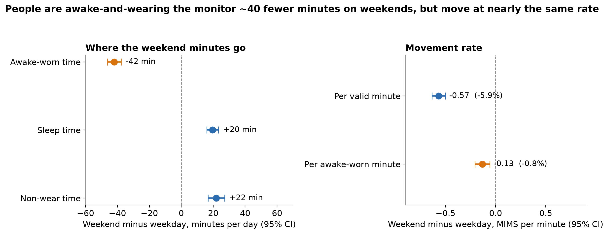
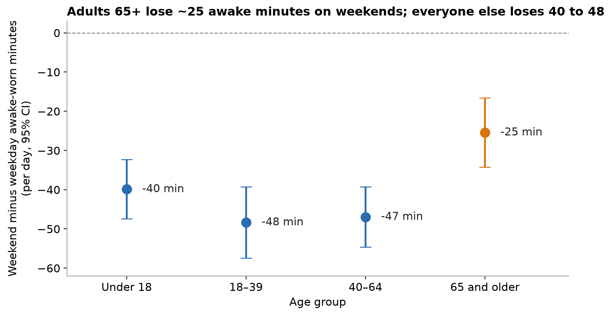
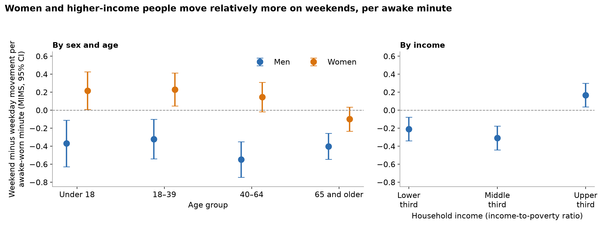
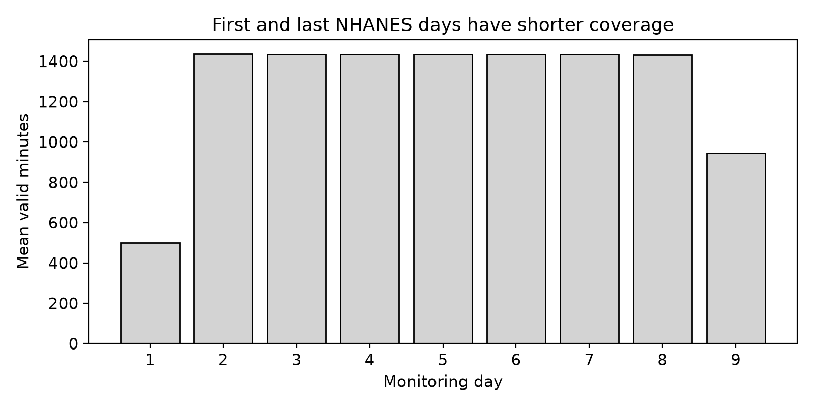

## Main Findings (Narrative Analysis)

Our question is: how does movement differ on weekends and weekdays, and for whom? Finding 1 answers whether people move more or less on weekends than on weekdays. Finding 2 answers whether that weekend change in awake time differs by age. Finding 3 answers whether weekend movement differs by sex and household income. We cannot say why any of these differences exist, because the data has nothing on jobs, school or caregiving, and we may look into the reasons later with additional datasets.

- **Finding 1:** Movement is almost the same on weekends and weekdays. At first glance weekdays looked noticeably higher, but most of that gap came from weekends having less awake time, with more time asleep or with the monitor off, and the difference shrinks to almost nothing after accounting for awake time.
- **Finding 2:** Adults 65 and older lose much less awake time on weekends than younger people do, so their weekends look more like their weekdays.
- **Finding 3:** While awake, men move less on weekends than on weekdays but women do not, so women's weekend movement holds up better. People in higher-income households also tend to move relatively more on weekends than lower-income households do.

**How to read these.** Every number comes from NHANES 2011-2012 (PAXDAY_G joined to DEMO_G on **SEQN**; 6,906 people, 47,639 monitoring days, days 2 to 8 only). Each person is compared with their own weekdays (a person fixed-effects regression, so a person who is always very active does not distort the comparison), standard errors are clustered by person, and every model controls for monitoring day. "MIMS" is the monitor's movement unit. "Valid minute" is any minute the monitor recorded properly (includes sleep and time the monitor was off), and "awake-worn minute" is a minute classified as awake while wearing it. The code is **analysis/narrative_results.py** (run from the repo root); every number below is in **results/narrative_results.json**, and **narrative.ipynb** runs it top to bottom. These are associations in one survey cohort, not causes.

### Finding 1: Weekends differ in how much time we are awake and wearing the monitor, much more than in how fast we move

The headline weekend/weekday comparison we started with (movement per valid minute) is 0.57 MIMS lower on weekends (CI: -0.63 to -0.50, about 5.9% of the weekday average of 9.58). Daily total movement is lower by 816 MIMS (CI: -911 to -722), also about 6%. But the weekend minutes are not spent the same way: people have about 42 fewer awake-worn minutes (CI: -46 to -38), about 20 more sleep minutes (CI: +16 to +23) and about 22 more non-wear minutes (CI: +17 to +27). Because sleep and non-wear minutes record almost no movement, they pull the per-valid-minute average down. When we control for sleep and non-wear minutes, the weekend gap shrinks from 0.57 to 0.11 (CI: -0.16 to -0.07), and when we divide daily movement by awake-worn minutes instead, the gap is 0.13 MIMS (CI: -0.21 to -0.06), under 1% of the weekday rate of 16.1. The rate result holds when we keep only days with at least 1,200 valid minutes (-0.13), only days with at least 600 awake-worn minutes (-0.13), drop Fridays (-0.09), or control for sleep minutes (-0.09); with survey weights it is +0.01 (CI: -0.08 to 0.11), which is no difference at all. One alternative explanation we ruled out is that activity simply declines across the monitoring week and weekends fall late in it: movement does fall steadily (day 8 is 1.35 MIMS per valid minute lower than day 2, CI: -1.46 to -1.25), and controlling for monitoring day lowers the headline gap from 0.75 to 0.57 before any of the other checks. The caveat is that we can only see the monitor, not why a minute is "non-wear" (a weekend swim and a forgotten monitor look the same), and the awake-minute rate still includes a little movement during sleep.

### Finding 2: Older adults' weekends look more like their weekdays

Finding 1 showed that weekends mostly change how much time we spend awake and wearing the monitor, so we asked who loses the most. The 42-minute weekend loss is not the same at every age. For people under 18 it is 40 minutes (CI: -47 to -32), for ages 18 to 39 it is 48 (CI: -57 to -39), for ages 40 to 64 it is 47 (CI: -55 to -39), and for adults 65 and older it is only 25 (CI: -34 to -17). Adults 65 and older therefore lose about 20 fewer minutes than everyone else (CI: 10 to 30; 6,906 people split as 1,988 under 18, 1,866 aged 18 to 39, 2,015 aged 40 to 64 and 1,037 aged 65 and older). This is also what explains an earlier result we had, that the weekend drop in movement per valid minute was smaller for 65+ (0.36 versus about 0.6 MIMS for younger groups): that gap is mostly a time-use difference, not a difference in effort. The pattern holds with survey weights (65+ lose 29 minutes, others 48 to 53; difference 21 minutes, CI: 9 to 34) and with days of at least 1,200 valid minutes (difference 18 minutes, CI: 8 to 28). An alternative explanation is that the monitor's wake, sleep and non-wear classification works differently for older adults, which would change these minutes without any change in behavior; we cannot test that with these data, and DEMO_G has no employment field, so we cannot say whether work or school schedules are the reason (ages under 18 and 65 and older are only rough stand-ins for students and retirees). Older adults also move slightly less per awake-worn minute on weekends (-0.25 MIMS, CI: -0.35 to -0.15), so their weekends are not identical to their weekdays.

### Finding 3: Men slow down on weekends and women do not, and higher-income people slow down less

Finding 2 looked at who differs in time. This finding looks at the other part, how hard people move while they are awake, measured as MIMS per awake-worn minute. Men move 0.40 MIMS less on weekends than on weekdays (CI: -0.52 to -0.29), while women move 0.13 more (CI: +0.04 to +0.23). After accounting for age group and income, women's weekend change is 0.59 higher than men's (CI: 0.44 to 0.74), and the difference points the same way in every age group (under 18: 0.58, CI 0.25 to 0.92; 18 to 39: 0.55; 40 to 64: 0.69; 65 and older: 0.30, CI 0.11 to 0.50). It does not come from sleeping in. Women and men lose a similar number of awake-worn minutes (a difference of +2 minutes, CI: -6 to +11), so the sex difference is in how they move while awake, not in how long they are awake. It also holds with survey weights (0.60), with days of at least 1,200 valid minutes (0.56), with days of at least 600 awake-worn minutes (0.61) and when we control for sleep minutes (0.57). Income also shows a pattern: each extra point of the income-to-poverty ratio goes with 0.14 more weekend movement per awake-worn minute (CI: 0.09 to 0.19; 6,281 people: 520 people have no income value and about 100 more have no day with 300 or more awake-worn minutes). It holds with weights (0.23), after adjusting for race and ethnicity (0.13) and among adults only (0.23), but only the upper income third differs (+0.17, CI: 0.04 to 0.30, while the lower and middle thirds are -0.21 and -0.31), so it is not a smooth trend, and income stands in for many things such as job type and free time. We left out education and BMI: education exists only for adults 20 and older, and BMI needs another NHANES file that we did not use. These are associations. They show who differs, not why.

### Analyses left out of the main story, and why

- **Fitbit weekday/weekend steps (32 volunteers):** the mean weekend-minus-weekday difference was -43 steps per day (CI: -1,075 to 988), which neither shows nor rules out a difference. Fitbit has no age, sex or income fields, so it cannot support any of the three findings above; the code remains in **eda.ipynb**.
- **Earlier NHANES finding (weekday movement 0.746 MIMS per valid minute higher):** this reproduced as 0.75 (0.57 after the monitoring-day control) but turned out to be mostly a time-use effect (Finding 1), so we replaced it.
- **Earlier age-group finding (weekday/weekend gap smallest for 65+, unweighted t-intervals):** reproduced as a smaller drop of 0.36 per valid minute, which Finding 2 re-expresses as a smaller loss of awake time.
- **Steps versus active minutes, sedentary and active minute distributions (Fitbit):** background descriptions in **eda.ipynb** that do not bear on the weekday/weekend questions.
- **Mixed-effects model with a random intercept per person:** the person fixed-effects model used above answers the same within-person question, so the mixed-model version in **narrative.ipynb** is included only as a cross-check.
- **BRFSS (self-reported exercise) and education/BMI:** not used, as they would need new data or cannot be linked to individuals.

### Data quality note: NHANES monitoring coverage (methods, not a finding)

The recording coverage varies across monitoring days. We compared average valid minutes using NHANES daily records. Day 1 averaged 501 minutes, with an approximate 95% confidence interval of 496 to 506 minutes. Day 9 averaged 944 minutes, with an interval of 939 to 949. Days 2 to 8 averaged about 1,431 to 1,436 minutes. Changing participants could affect these averages because some people have missing monitoring days. To check this, we repeated the comparison using the 6,608 participants with all nine records. Their day 1 average was about 502 minutes, day 9 was 944 minutes, and days 2 to 8 averaged about 1,438 minutes. The shorter first and last days remained when we compared the same participants. This suggests that changing participant composition does not fully explain the pattern. These results describe recording coverage, rather than how physically active participants were.

# cs418-Fitness-Analytics

Personal Exercise and Fitness Analytics group repository.

GROUP MEMBERS: Hashim, Shriya, Yumna, G, Guillermo

## Research Questions

**Question 1:** Do people move less on weekends, or do they mainly spend less time awake and wearing the monitor?

**Question 2:** Does the weekend shift in awake-worn time differ by age?

**Question 3:** Does weekend movement (per awake-worn minute) differ by sex and household income?

### Reproducing the Analysis

To reproduce our analysis:

1. Download the NHANES PAXDAY_G.XPT and DEMO_G.XPT datasets from the CDC.
2. Place both files in the `data/cdc/` directory.
3. Download the Fitbit dailyActivity_merged.csv dataset and place it in `data/fitbit/`.
4. From the repo root run `python analysis/narrative_results.py` (needs numpy, pandas, matplotlib), or open `narrative.ipynb` and Restart & Run All. This produces `results/narrative_results.json` and `figures/finding-one.png`, `finding-two.png` and `finding-three.png`, which are the numbers and figures in Main Findings.
5. `eda.ipynb` holds the earlier exploratory work (Fitbit and NHANES profiling).

Primary Datasets:
Fitbit Fitness Tracker Data: https://www.kaggle.com/datasets/arashnic/fitbit

Physical Activity Monitor - Day: https://wwwn.cdc.gov/nchs/nhanes/search/datapage.aspx?Component=Examination\&Cycle=2011-2012 (PAXDAY\_G)

Secondary Datasets:

Demographic Variables \& Sample Weights: https://wwwn.cdc.gov/nchs/nhanes/search/datapage.aspx?Component=Demographics\&Cycle=2011-2012 (DEMO\_G)

2011 BRFSS Data (SAS Transport Format): https://www.cdc.gov/brfss/annual\_data/annual\_2011.htm

Fitbit Fitness Tracker Data - Download 4.12.16-5.12.16 dailyActivity\_merged.csv(https://www.kaggle.com/datasets/arashnic/fitbit)

Shape - 940 rows and 15 columns

One row represents one recorded day of a single participant for up to a month (4.12.16 - 5.12.16)

The columns that we care about from this data are:

Id - int64

ActivityDate - String

TotalSteps - Int64

TotalDistance - Int64

VeryActiveMinutes - Int64

FairlyActiveMinutes - Int64

LightlyActiveMinutes - Int64

SedentaryMinutes - Int64

Calories - Int64

Physical Activity Monitor - Day Data - Download PAXDAY\_G Data \[XPT - 6.2 MB] (https://wwwn.cdc.gov/nchs/nhanes/search/datapage.aspx?Component=Examination\&Cycle=2011-2012)

Shape - 61168 rows and 15 columns

One row represents one day of a single participant wearing the recording device and each participant is recorded for 7 days and 2 partial days so they will each have 9 rows.
The columns that we care about from this data are:
SEQN - Float64

PAXDAYD - String

PAXDAYWD - String

PAXMTSD - Float64

PAXWWMD - Float64

PAXSWMD	- Float64

PAXNWMD - Float64

PAXVMD - Float64

PAXQFD - Float64

Demographic Variables \& Sample Weight Data - Download DEMO\_G \[XPT - 3.6 MB] (https://wwwn.cdc.gov/nchs/nhanes/search/datapage.aspx?Component=Demographics\&Cycle=2011-2012)

Shape - 9756 rows and 48 Columns

One row represents one participant of the survey

The columns that we care about are:

SEQN - Float64

RIAGENDR - Float64

RIDAGEYR - Float64

RIDRETH1 - Float64

INDFMPIR - Float64

DMDEDUC2 - Float64

WTMEC2YR - Float64

WTINT2YR - Float64

2011 BRFSS Data (SAS Transport Format)

Shape - 506467 rows and 454 columns (we will only use 7 columns)

One row represents one participant of the survey. For this survey, the adults were all over the age of 18.

The columns that we care about are:

\_STATE - Float64

SEX - Float64

\_AGEG5YR - Float64

\_BMI5 - Float64

\_TOTINDA - Float64

EXERANY2 - Float64

\_LLCPWT - Float64

The full data for the 2011 BRFSS file is over 1GB unzipped, so it will not be in the REPO. It can be downloaded from the following link: https://www.cdc.gov/brfss/annual\_data/annual\_2011.htm

Unzip it into data/cdc/ and run the notebook. In the REPO, we include a 1000 row sample found in samples/brfss\_2011\_sample.csv

**Exploratory analysis**

Details are in EDA.md and eda.ipynb.

**Data:** Our primary dataset is the Fitbit daily activity data (940 rows, 15 columns, one row per participant per day). NHANES is our secondary dataset (61,168 rows, 15 columns, 6,917 participants, one row represents one participant's physical activity monitoring for one day. Each participant was recorded daily for 9 days).

**Research questions:** Our current research questions are listed in the Research Questions section above. Earlier exploratory questions about steps and active minutes remain part of our background analysis.

**Anomalies:** 72 days look like the tracker wasn't worn (zero steps and 1,440 sedentary minutes), including 4 with zero calories. We flagged them and plan to drop them. Another 7 days have 1,440 sedentary minutes but also steps, so we're still deciding. We also converted the date column from text to a date. We found no duplicates, negatives, or nulls.

**Findings:** Steps and active minutes rise together but flatten above roughly 8,000 to 10,000 steps. Weekday (7,650) and weekend (7,607) averages are almost the same, but individuals vary a lot.

**NHANES:** We analyzed 61,168 daily activity records and cleaned suspicious near-zero values. Monitoring days 2-8 had nearly complete recordings, while days 1 and 9 were partial. Participants averaged 844.53 wake wear minutes on weekdays versus 788.02 on weekends. Average movement per valid minute was also higher on weekdays (9.58 MIMS) than on weekends (8.83 MIMS)

**Data Documentation**

\[DATASHEET.md](DATASHEET.md) - Datasets in and out with question details and ethics

Fitbit daily activity

source:
https://doi.org/10.5281/zenodo.53894

The first release uses CC By 4.0. Kaggle mirror lists CC), which therefore conflicts the origin release.

License:
https://creativecommons.org/licenses/by/4.0/

NHANES Physical Activity Monitor - Day

Source:
https://wwwn.cdc.gov/Nchs/Data/Nhanes/Public/2011/DataFiles/PAXDAY\_G.htm

NHANES dat are public use, NCHS requires stats usage

Terms:
https://www.cdc.gov/nchs/policy/data-user-agreement.html

Support datasets:
BRFSS were inspected during acquisition but not use in the curr EDA calculartion.

Biggest limitation:
Small sample size of volunteer on Fitbit, so it may not be representative of the general population of Fitbit users. Since the sample size is limited, we have limited demographic information, and potentially even incomplete tracker usage which would make the results harder to generalize. A limitation across the data (between Fitbit and NHANES) is that Fitbit measures steps while NHANES uses accelerometer-based MIMS measurements AND they involved different participants and collection periods, so they cannot be compared directly.
